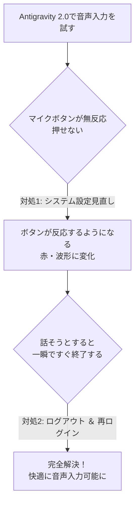

## はじめに

Google Antigravity 2.0 は、デスクトップアプリから Gemini 等のモデルと高速に対話できる開発者向け環境です。
便利な機能のひとつに **「音声入力（リアルタイム文字起こし）」** があります。プロンプト入力欄のマイクアイコンをクリックするか、キーボードショートカット（`Ctrl + M`）で手軽に思考を吹き込むことができます。

しかし、Mac環境で音声入力を使おうとした際、次のような二段階のトラブルに遭遇することがあります。

1. **第1段階**: マイクボタンや `Ctrl + M` を押しても**全く反応がない（ボタンが押せない）**
2. **第2段階**: 設定を見直してボタンが押せる（赤色・波形表示になる）ようになったが、**一瞬ですぐ入力モードが終わってしまい吹き込めない**

本記事では、この現象の原因と **2つの解決ステップ** をまとめます。

---

## トラブルの全体像

遭遇した現象の流れは以下の通りです。

---

## 解決策1：macOS のマイクアクセス権限を許可する

### 現象
* マイクボタンをクリックしても何も起きない
* `Ctrl + M` を押しても反応しない

### 原因
macOS のセキュリティ機能（TCC: Transparency, Consent, and Control）により、Antigravity アプリにマイクへのアクセス権が付与されていないためです。OSレベルでブロックされていると、UIのトグル動作自体が無効化されます。

### 対処手順
1. Macの **「システム設定」** を開く。
2. サイドバーの **「プライバシーとセキュリティ」** ＞ **「マイク」** を選択する。
3. リスト内の **「Antigravity」** を探して **オン（許可）** にする。
4. 設定後、Antigravity アプリを `Cmd + Q` で完全に終了し、再起動する。

これで、マイクボタンをクリックした際にアイコンが赤色や波形アニメーションに変わり、録音待機状態になるようになります。

---

## 解決策2：サインアウトして再ログインする

### 現象
* 解決策1によってマイクボタンは押せるようになった
* しかし、声を吹き込もうとすると **1〜2秒ですぐに入力モードが強制終了（キャンセル）** されてしまう

### 原因
認証の権限不足 です。

Antigravity の音声入力は、話した音声をリアルタイムでサーバーに送り、文字起こしをしています。公式ドキュメント（CLI の /voice コマンドのページ）には、次のように書かれています。

Voice dictation requires an updated authentication permission granted at sign-in.
（音声入力には、サインイン時に付与される新しい認証権限が必要です）

出典: https://antigravity.google/docs/cli/commands/voice/

音声入力機能が追加される前からサインインしたままのセッションには、この権限がありません。そのため、録音は始まっても文字起こしが失敗し、すぐに入力モードが終わってしまいます。

デスクトップアプリについては公式に記載がありません。ただ、症状も解決方法（サインインし直す）も同じなので、原因も同じだと考えられます。

### 対処手順
1. Antigravity 2.0 画面左下のユーザーアイコン、または **「Settings」** を開く。
2. **「Sign out」（ログアウト）** を実行する。
3. 再度 Google アカウントで **Sign in（再ログイン）** する。

:::note info
再ログインすると、音声入力に必要な権限を含めて認証し直されます。
これで録音がすぐに切れることなく、話した内容がプロンプト欄に文字起こしされるようになります。
:::

---

## 補足：音声入力のちょっとした仕様とTips

正常に入力できるようになった後に知っておくと役立つポイントです。

* **モデルによる制限はない**
  * Gemini 3.8 Flash でも 4 Argon でも、どのモデルを選んでいても利用可能です（アプリ側の入力支援機能であるため）。
* **1回の録音時間は約1分半〜2分が目安**
  * 会議全体の書き起こし用ではなくプロンプト入力用のため、一定時間の連続発話や長時間の沈黙（無音検知）で自動停止します。
* **終了方法**
  * 話し終わったら再度マイクボタン（または `Ctrl + M`）を押すだけでOKです。「えーっと」などのフィラーも適度に整理されて入力されます。

---

## おわりに

* **ボタンが反応しない → macOS の「プライバシーとセキュリティ ＞ マイク」を確認**
* **ボタンは動くがすぐ終わる → 一度「サインアウト ＆ 再サインイン」してトークンを更新**

Macで Antigravity 2.0 の音声入力につまずいた際は、ぜひこの2点を確認してみてください。

