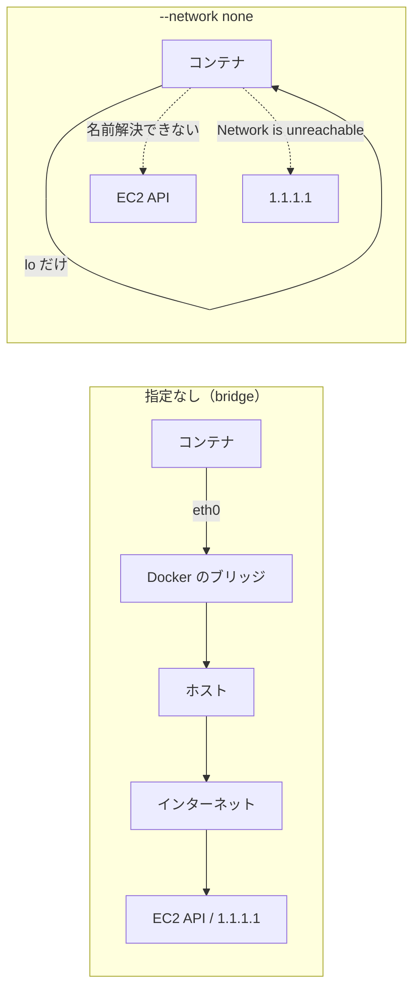

## はじめに

:::note info
**今日の Tips**
テストを隔離環境として Docker コンテナで動かすなら、`--network none` を付ける。コンテナからネットワークがなくなるので、テストが間違って本物の API を呼んでも、外へ出られません。
:::

前回、AWS CLI のスクリプトを、偽物の `aws` コマンドでテストする記事を書きました。

https://qiita.com/torifukukaiou/items/9d78420e2f44b0beda48

テストは、次のようにネットワークを切ったコンテナで実行しました。

```bash
docker run --rm -it --network none -v "$PWD":/work -w /work debian:bookworm-slim bash
```

`--network none` を付けると、コンテナから外へ通信できなくなります。本当にそうなのか、付けた場合と付けない場合で比べてみました。

## 確かめ方

`debian:bookworm-slim` には、`curl` も `ip` コマンドも入っていません。そこで bash の `/dev/tcp` を使います。

`/dev/tcp/ホスト/ポート` にリダイレクトすると、bash がそのホストとポートに TCP で接続します。つながれば `CONNECTED`、つながらなければ `FAILED` と表示するようにしました。待ち時間は `timeout 3` で3秒に区切っています。

接続先は2つです。

| 接続先 | 何か | 選んだ理由 |
|---|---|---|
| `ec2.ap-northeast-1.amazonaws.com:443` | EC2 の API エンドポイント（東京リージョン） | `aws ec2 stop-instances` が実際に通信しに行く相手 |
| `1.1.1.1:443` | Cloudflare の公開 DNS サーバー | IP アドレスを直接指定して、名前解決を飛ばすため |

### 1.1.1.1 とは

`1.1.1.1` は、Cloudflare が提供している公開 DNS サーバーの IP アドレスです。覚えやすい IP アドレスなので、接続テストの相手によく使われます。

DNS over HTTPS（DoH）にも対応しているので、DNS の 53 番ポートだけでなく、HTTPS の 443 番ポートでも待ち受けています。今回は 443 番ポートにつないでいます。

ホスト名ではなく IP アドレスで指定しているのがポイントです。「DNS が引けないだけで、IP アドレスを直接指定すれば届くのでは？」という疑問を確かめられます。

## 結果

### EC2 の API エンドポイント

**コマンド実行**

```bash
docker run --rm debian:bookworm-slim bash -c 'timeout 3 bash -c "echo > /dev/tcp/ec2.ap-northeast-1.amazonaws.com/443" && echo CONNECTED || echo FAILED'
```

**結果**

```text
CONNECTED
```


**コマンド実行**

```bash
docker run --rm --network none debian:bookworm-slim bash -c 'timeout 3 bash -c "echo > /dev/tcp/ec2.ap-northeast-1.amazonaws.com/443" && echo CONNECTED || echo FAILED'
```

**結果**

```text
bash: line 1: ec2.ap-northeast-1.amazonaws.com: Temporary failure in name resolution
bash: line 1: /dev/tcp/ec2.ap-northeast-1.amazonaws.com/443: Invalid argument
FAILED
```

`--network none` では、接続より手前の名前解決（DNS）で失敗しています。

### 1.1.1.1（IP アドレスを直接指定）

```bash
docker run --rm debian:bookworm-slim bash -c 'timeout 3 bash -c "echo > /dev/tcp/1.1.1.1/443" && echo CONNECTED || echo FAILED'
```

```text
CONNECTED
```

```bash
docker run --rm --network none debian:bookworm-slim bash -c 'timeout 3 bash -c "echo > /dev/tcp/1.1.1.1/443" && echo CONNECTED || echo FAILED'
```

```text
bash: connect: Network is unreachable
bash: line 1: /dev/tcp/1.1.1.1/443: Network is unreachable
FAILED
```

名前解決を飛ばしても、`Network is unreachable` で失敗しました。

### まとめると

| 接続先 | 指定なし | `--network none` |
|---|---|---|
| `ec2.ap-northeast-1.amazonaws.com:443` | CONNECTED | FAILED（名前解決できない） |
| `1.1.1.1:443` | CONNECTED | FAILED（ネットワークに到達できない） |

## なぜ届かないのか

Docker のドキュメントには、`none` ドライバーを使うと、コンテナ内にはループバックデバイスしか作られないと書かれています。

https://docs.docker.com/engine/network/drivers/none/

外へ出るための口（`eth0`）が、そもそもありません。名前解決もできないし、IP アドレスを直接指定しても経路がありません。



## おわりに

- `--network none` のコンテナからは、ホスト名でも IP アドレスでも外へ出られない
- ホスト名の場合は名前解決で、IP アドレスの場合は経路がないところで止まる
- `curl` が無くても、bash の `/dev/tcp` で接続の可否を確かめられる

前回の記事のテスト用コンテナには、本物の AWS CLI も認証情報も入っていません。仮に入っていたとしても、`--network none` なら AWS の API まで届きません。「AWS へ接続せずにテストする」ことを、中身ではなく構成で保証できます。

テストで外部と通信してほしくないときは、`--network none` を付けておくと安心です。


