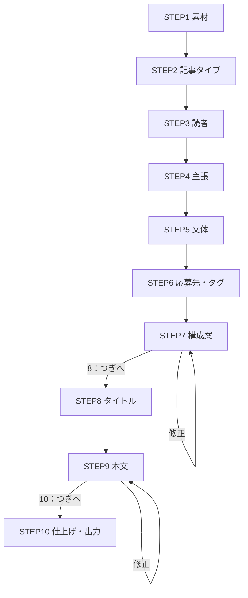

## はじめに

:::note info
note で覚えた「番号で進むプロンプト構成」を、Qiita 記事作成のスキルにしました。素材を渡して番号を選んでいくだけで、事実ベースの記事の下書きまでたどり着きます。
:::

公開リポジトリ `tokon-agent-skills` に、`qiita-article` スキルを追加しました。

https://github.com/TORIFUKUKaiou/tokon-agent-skills

じつは、この記事もこのスキルで書いています。

## 番号で進むプロンプト構成は、note で覚えた

それまで私は、生成 AI を一問一答でしか使っていませんでした。こちらが聞いて、答えが返ってきて、それで終わりです。

[note](https://note.com/) では、AI が情報を受け取ると、自分から聞き返しているかのように次の質問を出し、やり取りがつながっていく使い方を見かけました。最初のプロンプトでそう指示しておけば、それができる。これが新鮮でした。いくつもの記事を読んで、研究しました。

note でも、私と同業の人たちをよく見かけました。ソフトウェア開発を仕事にしている人たちが、note で発信してくださっているのかもしれません。

そこで私も、この構成でスキルを作りました。同じリポジトリにある `tokon-novel` です。悩みや日常のできごとを素材に、主人公、舞台、相方、決め技……と番号で選んでいくと、短編ライトノベルができあがります。

`tokon-novel` で作ったライトノベルは、note のマガジンにまとめています。

https://note.com/awesomey/m/m24ea6308bbc8

作ったライトノベルの例です。

https://note.com/awesomey/n/n3b404bcced49?magazine_key=m24ea6308bbc8

https://note.com/awesomey/n/n02ecefe36511?magazine_key=m24ea6308bbc8

https://note.com/awesomey/n/n956c49dd5a73?magazine_key=m24ea6308bbc8

ライトノベルでできるなら、もともと論理立てて書くことが求められる技術記事とも、相性がよいのではないか。そう考えて、Qiita 記事を作るときも同じ構成で進められるようにしました。

## qiita-article スキルの流れ

スキルは、10 の STEP で進みます。

| STEP | 決めること |
|---|---|
| 1 | 素材（検証ログ、メモ、困りごと、既存の下書き、テーマだけ、など） |
| 2 | 記事タイプ（Tips、検証・やってみた、トラブル解決、実録・事例紹介） |
| 3 | 読者 |
| 4 | 主張（この記事で言いたい一文） |
| 5 | 文体（技術記事調、語り口調、闘魂連鎖ユニバース入り） |
| 6 | 応募先・タグ |
| 7 | 記事構成案 |
| 8 | タイトル |
| 9 | 本文作成 |
| 10 | 仕上げ・出力（チャット表示、md ファイル保存、アイキャッチ案） |

進め方のルールは次のとおりです。

- 質問は 1 問ずつ
- 選択肢には番号を振り、数字だけで答えられる
- どの STEP にも「おまかせ」があり、自由記載も受け付ける
- 構成案と本文は、「8：つぎへ」「10：つぎへ」と入力するまで次へ進まない。直したいときは、そのまま修正内容を書く

## 事実だけで書かせる「技術記事の掟」

技術記事は、読者が手を動かす前提で読まれます。そこでスキルには、文体や型に関係なく守る「技術記事の掟」を書きました。

| 掟 | 中身 |
|---|---|
| 事実 | コマンド、出力、バージョン、URL は素材にあるものだけを使う。足りない事実は `【TODO：〇〇を確認】` と書いて残す |
| 機密 | API キー、社名、個人名、アカウント ID などは伏せるか架空の値に置き換え、置き換えたものを一覧で示す |
| 主張 | 主張とタイトルは同じことを言う。自分の記事を持ち上げる言葉は使わない。結論は冒頭に置く |
| Qiita 記法 | `:::note info` の囲み、ファイル名付きのコードブロック、mermaid の予約語、`@` のメンションなどに気をつける |

いちばん効くのは、「足りない事実は作らずに TODO で残す」です。スキルの冒頭にも、こう書いています。

> ただし、王者の強さは盛ることではありません。**素材にある事実だけで、真正面から書き切ること**です。

## 実際に使ってみた

この記事を作ったときの、実際のやり取りです。

| STEP | 私の回答 |
|---|---|
| 1 素材 | qiita-article スキルそのもの、`https://github.com/TORIFUKUKaiou/tokon-agent-skills` を紹介する記事。番号でステップが進んでいく構成は note で学んだ（エピソード）。 |
| 2 記事タイプ | 5（おまかせ）→ 実録・事例紹介 |
| 3 読者 | 5（おまかせ） |
| 4 主張 | 6（おまかせ） |
| 5 文体 | 2（語り口調） |
| 6 応募先・タグ | 闘魂連鎖 をいれてください。他はおまかせします。 |
| 7 構成案 | 8（つぎへ） |
| 8 タイトル | 1 |

半分以上「おまかせ」ですが、ちゃんと最後まで進みました。

note のエピソードは、素材に詳しく書きませんでした。そのため構成案の段階で、TODO として挙がってきました。スキルが勝手にそれらしい話を作らず、聞き返してくれたのは狙いどおりです。

## V9 王者のロール

このスキルで記事を書くのは、「Qiita 記事執筆世界選手権王者・V9 レジェンド（the マスターオブマスターズ）」です。腰には黄金のチャンピオンベルト、ブロマイドは馬鹿売れ、という設定です。

`tokon-agent-skills` のほかのスキル（`infographic`、`apios-acrostic`、`git-commit`、`tokon-novel`）も、それぞれの世界選手権の V9 王者が担当しています。

## 使い方

スキルの入れ方は、各エージェントの公式ドキュメントを見てください。

- [Codex](https://learn.chatgpt.com/docs/build-skills)
- [Claude Code](https://code.claude.com/docs/en/skills)
- [Google Antigravity](https://antigravity.google/docs/skills)

スキル本体はこちらです。

https://github.com/TORIFUKUKaiou/tokon-agent-skills/blob/main/skills/qiita-article/SKILL.md

スキルの領域を汚したくない人は、mdの内容をプロンプトに貼ることでも動くと思います（あくまでも思います）。

## おわりに

- note で覚えた「番号で進むプロンプト構成」を、Qiita 記事作成のスキルにした
- 番号を選ぶだけで、事実ベースの下書きまで進む
- 足りない事実は作らずに TODO で残すので、書き手が埋めるところがはっきりする

番号で進む構成は、note で受け取ったバトンでした。このスキルが、次の 1 本を書く誰かのバトンになればうれしいです。<ruby>闘魂<rp>（</rp><rt>投稿</rt><rp>）</rp></ruby>連鎖です。

