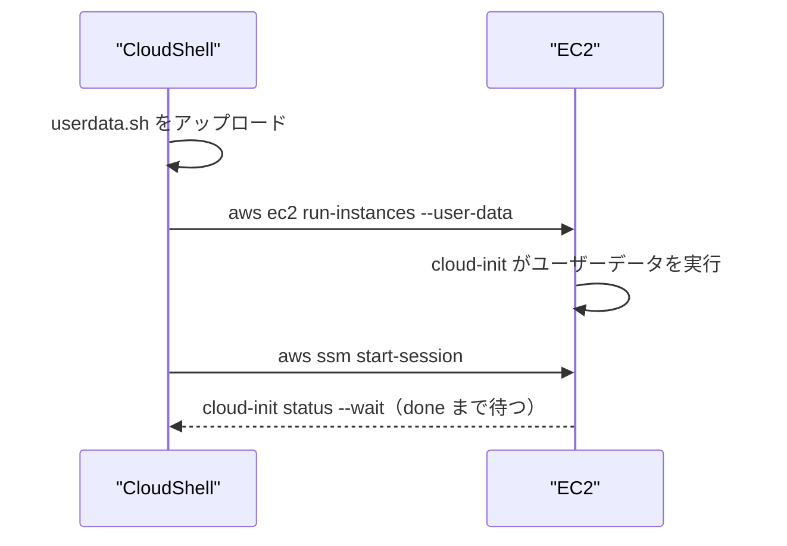

## はじめに

おはヨーグルト。こんにちは。こんばんは。
名乗るほどの者ではございませんが、闘魂家の**A**wesome YAMAUCH**I**、略して**AI**です。

:::note info
**今日の Tips**

EC2 の作業は、ブラウザの CloudShell だけで済みます。手元の PC に、AWS CLI もキーペアも Session Manager のプラグインも要りません。

- ファイルを渡す：「アクション」→「ファイルのアップロード」
- 起動する：`aws ec2 run-instances --user-data file://userdata.sh`
- 入る：`aws ssm start-session --target {インスタンスID}`
- 起動完了を待つ：`cloud-init status --wait`
:::

この記事では、Docker でアプリケーションを動かすユーザーデータを付けて EC2 を起動し、ユーザーデータが最後まで終わったことを確かめるところまでを、CloudShell だけで行います。



## 前提

- AWS マネジメントコンソールにサインインし、上部のアイコンから CloudShell を開いていること。
- リージョンにデフォルト VPC があること。ネットワーク構築で記事の焦点をぼかさないため、VPC やサブネットの作成は省き、デフォルト VPC を使います（`--vpc-id` や `--subnet-id` の指定も省略できます）。
- Session Manager で入るためのインスタンスプロファイルがあること。ロールには、AWS 管理ポリシー `AmazonSSMManagedInstanceCore` を付けておきます。この記事では、名前を `ssm-ec2-profile` とします（自分の環境のインスタンスプロファイル名に置き換えてください）。

キーペアも、SSH のための 22 番ポートも使いません。

:::note info
**デフォルト VPC の確認と作成**

デフォルト VPC があるかは、次のコマンドで確かめられます。

```bash
aws ec2 describe-vpcs \
  --filters Name=is-default,Values=true \
  --query 'Vpcs[0].VpcId' \
  --output text
```

`vpc-` から始まる ID が返ればそのまま進めます。`None` が返った場合は、次のコマンドで作成できます。

```bash
aws ec2 create-default-vpc
```
:::

## ユーザーデータを CloudShell に上げる

手元で `userdata.sh` を作ります。中身は、Docker を公式リポジトリから入れ、公開リポジトリ [haw/strong-system-dot-com](https://github.com/haw/strong-system-dot-com) の社員名簿アプリを起動するものです。

```bash:userdata.sh
#!/bin/bash
set -euxo pipefail
exec > >(tee -a /var/log/userdata.log) 2>&1

# t3.micro のメモリ不足対策（2GB のスワップ）
fallocate -l 2G /swapfile
chmod 600 /swapfile
mkswap /swapfile
swapon /swapfile

# Docker（公式リポジトリ）
apt-get update
apt-get install -y ca-certificates curl git
install -m 0755 -d /etc/apt/keyrings
curl -fsSL https://download.docker.com/linux/ubuntu/gpg \
  -o /etc/apt/keyrings/docker.asc
chmod a+r /etc/apt/keyrings/docker.asc
ARCH=$(dpkg --print-architecture)
CODENAME=$(. /etc/os-release && echo "$VERSION_CODENAME")
echo "deb [arch=$ARCH signed-by=/etc/apt/keyrings/docker.asc] \
https://download.docker.com/linux/ubuntu $CODENAME stable" \
  > /etc/apt/sources.list.d/docker.list
apt-get update
apt-get install -y docker-ce docker-ce-cli containerd.io \
  docker-buildx-plugin docker-compose-plugin
usermod -aG docker ubuntu

# アプリ（社員名簿）を取得して、MySQL のコンテナと一緒に起動する
sudo -u ubuntu git clone --depth 1 \
  https://github.com/haw/strong-system-dot-com.git \
  /home/ubuntu/strong-system-dot-com
cd /home/ubuntu/strong-system-dot-com/docs/2026/app
sudo -u ubuntu docker compose build --pull
sudo -u ubuntu docker compose up -d --pull always

echo "userdata completed"
```

CloudShell の画面右上の「アクション」から「ファイルのアップロード」を選びます。「参照」で `userdata.sh` を選び、「アップロード」を押します。ファイルは、ホームディレクトリ（`/home/cloudshell-user`）の直下に置かれます。


```bash
ls -l ~/userdata.sh
```

:::note info
「ファイルのアップロード」で選べるのは、1回に1ファイルです。複数のファイルを渡すときは、zip にまとめて上げ、CloudShell で展開すると手早く済みます。
:::

## ユーザーデータ付きで EC2 を起動する

まず、アプリケーションの 3000 番ポートへアクセスするためのセキュリティグループを作ります。`--vpc-id` を省略すると、デフォルト VPC に作られます。

```bash
SG_ID=$(aws ec2 create-security-group \
  --group-name cloudshell-demo-sg \
  --description "Allow HTTP 3000" \
  --query 'GroupId' \
  --output text)
```

```bash
aws ec2 authorize-security-group-ingress \
  --group-id "$SG_ID" \
  --protocol tcp \
  --port 3000 \
  --cidr 0.0.0.0/0
```

AMI は、Canonical が公開している SSM パラメータから、Ubuntu 24.04 の最新のものを指定します。

```bash
UBUNTU=/aws/service/canonical/ubuntu/server/24.04/stable/current
```

```bash
AMI="resolve:ssm:$UBUNTU/amd64/hvm/ebs-gp3/ami-id"
```

`--security-group-ids` に作成したセキュリティグループを指定し、`--user-data file://` でアップロードしたファイルを渡します。`--subnet-id` を省略すると、デフォルト VPC のサブネットが自動で選ばれ、パブリック IPv4 アドレスも付与されます。起動したインスタンスの ID を、変数 `IID` に入れます。

```bash
IID=$(aws ec2 run-instances \
  --image-id "$AMI" \
  --instance-type t3.micro \
  --security-group-ids "$SG_ID" \
  --iam-instance-profile Name=ssm-ec2-profile \
  --user-data file://userdata.sh \
  --tag-specifications 'ResourceType=instance,Tags=[{Key=Name,Value=cloudshell-demo}]' \
  --query 'Instances[0].InstanceId' \
  --output text)
```

```bash
echo "$IID"
```

出力例：`i-0123456789abcdef0`

## CloudShell から Session Manager で入る

CloudShell には、Session Manager のプラグインが最初から入っています。

```bash
session-manager-plugin --version
```

出力例：`1.2.835.0`

インスタンスに入ります。

```bash
aws ssm start-session --target "$IID"
```

セッションが始まり、プロンプト（`$`）が表示されます。

```text
Starting session with SessionId: user-jygoznv6bq57jzcrc7istf8tkq
$
```

起動した直後は、SSM エージェントの登録が終わっておらず、`TargetNotConnected` になることがあります。そのときは、少し待ってからやり直します。

入った直後のユーザーは `ssm-user`、シェルは `sh` です。使い慣れたシェルにするなら、`bash` と打ちます。

## ユーザーデータの完了を待つ

ユーザーデータは、cloud-init が起動時に実行しています。終わるまで待つには、次のコマンドを使います。

```bash
cloud-init status --wait
```

終わるまで `.` を出し続け、終わると状態を表示します。成功すると、`status: done` になります。

ユーザーデータの途中でコマンドが失敗すると、`status: error` になります。`set -euxo pipefail` を書いておくと、失敗した時点で止まるので、ここで気付けます。

失敗したときは、どこで止まったかを次のコマンドで見ます。

```bash
cloud-init status --long
```

ユーザーデータの出力は、`/var/log/cloud-init-output.log` に残ります。この記事の `userdata.sh` では、`/var/log/userdata.log` にも残しています。

```bash
sudo tail -n 20 /var/log/userdata.log
```

最後の行に `userdata completed` と出ていれば、スクリプトの末尾まで実行されています。

## 動いたことを確かめる

入った直後の `ssm-user` のままでは `/home/ubuntu` 配下に入れないため、`ubuntu` ユーザーに切り替えてからアプリケーションのディレクトリへ移動します。

```bash
sudo -iu ubuntu
```

```bash
cd /home/ubuntu/strong-system-dot-com/docs/2026/app
```

コンテナの状態を見ます。

```bash
sudo docker compose ps
```

実行結果：

```text
NAME        IMAGE         COMMAND                  SERVICE   CREATED         STATUS                   PORTS
app-app-1   app-app       "docker-entrypoint.s…"   app       6 minutes ago   Up 6 minutes             0.0.0.0:3000->3000/tcp, [::]:3000->3000/tcp
app-db-1    mysql:8.4.5   "docker-entrypoint.s…"   db        6 minutes ago   Up 6 minutes (healthy)   127.0.0.1:3306->3306/tcp, 33060/tcp
```

`app` と `db` の両方が `Up` になっています。アプリケーションに、EC2 の中からアクセスしてみます。

```bash
curl -s localhost:3000/api/health
```

実行結果：

```json
{"source":"local","host":"db","database":"employee_db","ok":true,"error":null,"server":"cbfc81773581","version":"8.4.5"}
```

`"ok":true` が返れば、アプリケーションが MySQL につながって動いています。

Session Manager のセッションは、`exit` を何回か打って抜けます（`ubuntu` ユーザーと `ssm-user` のそれぞれから抜けます）。

CloudShell に戻ったら、インスタンスのパブリック IP アドレスを調べます。

```bash
aws ec2 describe-instances \
  --instance-ids "$IID" \
  --query 'Reservations[0].Instances[0].PublicIpAddress' \
  --output text
```

セキュリティグループで 3000 番ポートを開けてあるので、ブラウザで `http://<パブリックIPアドレス>:3000` を開くと、社員名簿の画面が表示されます。


## 後片付け

CloudShell からインスタンスを削除します。

```bash
aws ec2 terminate-instances --instance-ids "$IID"
```

実行結果：

```json
{
    "TerminatingInstances": [
        {
            "InstanceId": "i-08b4e8cf1d84114b9",
            "CurrentState": {
                "Code": 32,
                "Name": "shutting-down"
            },
            "PreviousState": {
                "Code": 16,
                "Name": "running"
            }
        }
    ]
}
```

インスタンスが完全に終了するのを待ってから、セキュリティグループも削除します。

```bash
aws ec2 wait instance-terminated --instance-ids "$IID"
aws ec2 delete-security-group --group-id "$SG_ID"
```

## おわりに

EC2 にユーザーデータを付けて起動し、終わったことを確かめるまでを、CloudShell だけで行いました。

- ファイルは「アクション」→「ファイルのアップロード」で渡せる。
- `aws ec2 run-instances --user-data file://` で、上げたファイルをそのまま渡せる。
- `aws ssm start-session` で、キーペアなしで入れる。
- `cloud-init status --wait` で、ユーザーデータが終わるまで待てる。

どれも、手元の PC には何も入れていません。ブラウザがあれば、どこからでも同じ手順で作業できます。

参考にしたドキュメント：

https://docs.aws.amazon.com/cloudshell/latest/userguide/getting-started.html

https://docs.aws.amazon.com/AWSEC2/latest/UserGuide/user-data.html


