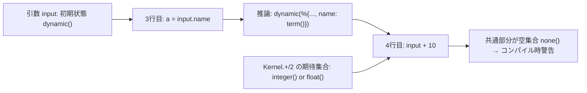

# 【Elixir 1.20 型システム入門 #1】型注釈なしで警告が出る仕組み ―― 集合論的型と dynamic() を実機で確かめる


## はじめに

:::note info
この記事のまとめ

Elixir 1.20 では、新しい設定や型注釈を書かなくても、いつものように実行・コンパイルするだけでコンパイラが自動で型をチェックしてくれます。

最初に小難しい型理論を覚える必要はありません。**「コンパイラが `warning:` を出したら、そこを丁寧につぶしていく」**――まずはそれだけで十分です。この記事では、その警告メッセージがなぜ出るのかを、最小のコードと実機ログで確かめます。
:::

Elixir の集合論的型システムは 1.17 から段階的に組み込まれ、2026年6月3日リリースの **Elixir 1.20** で全言語構文の型推論・型チェックが揃い、公式に「段階的型付け言語（gradually typed language）」となりました。

https://elixir-lang.org/blog/2026/06/03/elixir-v1-20-0-released/

本連載では、1.17〜1.19 の過去バージョンの変遷は追わず、**Elixir 1.20 の仕様をベースに全5回で型システムの挙動を実機確認**していきます。

### 検証環境

手元で確認した環境は次のとおりです。

```bash
elixir --version
```

```text
Erlang/OTP 29 [erts-17.1.1] [source] [64-bit] [smp:10:10] [ds:10:10:10] [async-threads:1] [jit]

Elixir 1.20.5 (compiled with Erlang/OTP 29)
```

### 連載の全体予定（全5回）

| 回 | テーマ | 主な確認内容 |
| :--- | :--- | :--- |
| **第1回（今回）** | 段階的型付け言語になった Elixir 1.20 の仕組み | 集合論的型、`dynamic()`、Dialyzer との違い |
| **第2回** | 注釈ゼロの型推論を実機で検証する | ガード・タプル・マップ・構造体のキー型推論 |
| **第3回** | 節をまたぐ型絞り込み（Occurrence Typing） | 複数 clause、`case` / `cond` / `with` と冗長節の検出 |
| **第4回** | アプリ横断の推論と `dynamic()` の境界 | 標準ライブラリ・別モジュール・依存パッケージをまたぐ推論 |
| **第5回** | 1.20 の現在地と 1.21 以降の展望 | 型シグネチャの位置づけ、実務での書き方と注意点 |

---

## Elixir 1.20 の型システムとは

Elixir 1.20 の型システムは、公式ドキュメント「Gradual set-theoretic types」で解説されています。この記事では、その内容を次の3つの柱に整理して紹介します。

https://elixir.hexdocs.pm/1.20.5/gradual-set-theoretic-types.html


### 1. 集合論的型（Set-theoretic types）

すべての型を「取りうる値の集合」として扱い、集合演算で組み合わせます。

- **和集合（`or`）**：どちらかの集合に属する値（例：`integer() or float()`）
- **共通部分（`and`）**：両方の集合に同時に属する値（例：`atom() and integer()` は重ならないため空集合 `none()`）
- **否定（`not`）**：特定の型を除いた集合（例：`not integer()` は整数以外のすべての値）

また、すべての値を含む集合を `term()`、値が1つも存在しない空集合を `none()` と表します。

### 2. `dynamic()` による段階的型付け

動的型付けのコードに型チェックを組み込む際、型がわからない値を単純に `any` として扱ってチェックを放棄する方法もあります。

これに対し、Elixir は `dynamic()` という型を使います。公式ドキュメントでは `dynamic()` は「型の範囲（a range of types）」として説明されています。

- 渡された値の型範囲（例：`dynamic(nil or integer())`）と、操作が期待する型集合の間に **1つでも共通部分があれば警告を出さない**
- 範囲内の **どの型を取りうる場合でも確実に失敗する（共通部分が空集合 `none()` になる）ときだけコンパイル時に警告を出す**

なお、関数から `dynamic()` を排した静的なコードに対しては、通常の静的型システムと同様に厳密に振る舞います。

### 3. 型注釈なしで自動適用される

Elixir 1.20.5 の時点では、ユーザーが型システム用の型シグネチャを書く構文はまだ導入されていません。公式ドキュメントにも次のように明記されています。

> User provided type signatures are planned for future releases.

また、従来からある `@spec` もこのコンパイラ型検査の根拠としては使われず、コンパイラは **パターンマッチ・ガード節・関数本体** から自動で型を推論します。

---

## 実験1：型注釈ゼロの引数で矛盾を起こす

まず、引数に型注釈もガードも一切書かない関数の中で、互いに矛盾する2つの操作を行ってみます。

```elixir:exp1_dynamic.exs
defmodule TypeLab do
  def demo_dynamic(input) do
    a = input.name
    b = input + 10
    {a, b}
  end
end
```

`elixir` コマンドでそのまま実行します（今回はモジュール定義のみのため、コンパイル時の警告だけが確認できます）。

```bash
elixir exp1_dynamic.exs
```

```text
    warning: incompatible types given to Kernel.+/2:

        input + 10

    given types:

        dynamic(%{..., name: term()})-, integer()

    but expected one of:

        #1
        integer(), integer()

        #2
        integer(), float()

        #3
        float(), integer()

        #4
        float(), float()

    where "input" was given the type:

        # type: dynamic(%{..., name: term()})
        # from: exp1_dynamic.exs:3:7
        a = input.name

    type warning found at:
    │
  4 │     b = input + 10
    │               ~
    │
    └─ exp1_dynamic.exs:4:15: TypeLab.demo_dynamic/1
```

終了コードは `0` で、型エラーではなく `warning:`（警告）として出力されました。出力の中身を上から順に読み解きます。

### 1. `given types:` とオープンマップの推論

`input` に対して、渡された型は `dynamic(%{..., name: term()})` と表示されています。

3行目の `input.name`（マップまたは構造体へのキーアクセス）から、コンパイラは「`input` は少なくとも `:name` キーを持ち、それ以外にも任意のキーを持ちうるマップ（オープンマップ `%{..., name: term()}`）である」と自動推論しました。

### 2. `but expected one of:` に並ぶ4パターン

`Kernel.+/2` に対して、期待する引数の組み合わせが `#1` 〜 `#4` まで4つ並んでいます。`integer()` と `float()` の組み合わせ（複数のシグネチャの交差型（intersection）として表現される4通り）です。

`dynamic(%{..., name: term()})` が表す集合（マップ）と、`integer() or float()` の集合には共通部分が1つもない（`none()`）ため、この加算は確実に失敗すると判定され、警告が出ています。

### 3. `where` 欄による発生源トレース

```text
    where "input" was given the type:

        # type: dynamic(%{..., name: term()})
        # from: exp1_dynamic.exs:3:7
        a = input.name
```

警告が出たのは4行目の `input + 10` ですが、コンパイラは「その変数 `input` がどの行・どの式からその型と推論されたか」まで `where` 欄に表示します。



---

## 実験2：`is_integer` は警告なし、`is_number` で警告が出る

次に、集合の「否定（`not`）」が複数節（clause）にどう働くかを確かめます。1節目のガードだけを `is_integer(x)` と `is_number(x)` に変えた2つのモジュールを並べて実行します。

```elixir:exp2_negation.exs
defmodule TypeLabInt do
  def demo_negation(x) when is_integer(x), do: x * 2
  def demo_negation(x), do: x + 1
end

defmodule TypeLabNum do
  def demo_negation(x) when is_number(x), do: x * 2
  def demo_negation(x), do: x + 1
end
```

実行します。

```bash
elixir exp2_negation.exs
```

```text
    warning: incompatible types given to Kernel.+/2:

        x + 1

    given types:

        dynamic(not float() and not integer())-, integer()

    but expected one of:

        #1
        integer(), integer()

        #2
        integer(), float()

        #3
        float(), integer()

        #4
        float(), float()

    where "x" was given the type:

        # type: dynamic(not float() and not integer())
        # from: exp2_negation.exs:8:21
        x

    type warning found at:
    │
  8 │   def demo_negation(x), do: x + 1
    │                               ~
    │
    └─ exp2_negation.exs:8:31: TypeLabNum.demo_negation/1
```

`TypeLabInt` からは警告が一切出ず、`TypeLabNum` の8行目に対してのみ警告が出力されました。2つのモジュールの挙動の差は、集合の引き算（否定）で説明できます。


### `TypeLabInt` に警告が出ない理由

1. 1節目の `when is_integer(x)` で `integer()` の集合が処理されます。
2. 1節目を通過して2節目に到達した `x` は、`not integer()`（整数以外のすべて）と推論されます。
3. `not integer()` の中には **`float()` がまだ残っています**。
4. `Kernel.+/2` は `float() + integer()` を受け取れるため、2節目の集合と期待集合の共通部分（`float()`）が空にならず、警告は出ません。

### `TypeLabNum` で警告が出る理由

1. `is_number(x)` は `integer() or float()` の両方にマッチするガードです。
2. 1節目を通過して2節目に到達した `x` は、警告ログの `given types:` にあるとおり **`dynamic(not float() and not integer())`** と推論されます。
3. 残った集合には `integer()` も `float()` も1つも存在しないため、`Kernel.+/2` の期待集合との共通部分が空集合（`none()`）になります。
4. したがって、2節目の `x + 1` はどの値が来ても確実に失敗すると判定され、コンパイル時に警告が出ます。

---

## 従来の Dialyzer との違い

Erlang/OTP の静的解析ツールである Dialyzer は、サクセス・タイピング（Success Typing）に基づき、確実に失敗するコードだけを指摘して誤検知（偽陽性）を抑えます。Elixir 1.20 の型システムは理論が異なりますが、`dynamic()` を含む値については確実に失敗する場合にだけ警告するため、誤検知を抑えるという振る舞いは似ています。一方で、実行場所や情報の扱い方には明確な違いがあります。

| 観点 | 従来の Dialyzer | Elixir 1.20 の型システム |
| :--- | :--- | :--- |
| **基本理論** | サクセス・タイピング（正常終了するパスが残るかを中心に解析） | 段階的集合論的型（和 `or`・交差 `and`・否定 `not` と `dynamic()`） |
| **実行タイミング** | 別ツール（`dialyzer` / `mix dialyzer`）として事前 PLT 構築のうえ実行 | 標準コンパイラに統合（`elixir` / `elixirc` / `mix compile` で自動実行） |
| **解析対象** | BEAM ファイルに含まれる debug_info（抽象コード）と `@spec` | Elixir の構文（パターンマッチ、ガード節、関数本体） |
| **型注釈** | `@spec` / `@type` で明示可能 | 1.20 時点では構文なし（`@spec` も使わずコードから自動推論） |
| **警告の提示** | 必ず失敗する呼び出しや到達しないコード、型契約（`@spec`）と実装の食い違いを指摘 | 渡した型・期待型に加え、`where` 欄で型推論の発生源（行・列・式）を表示 |

---

## まとめと次回予告

第1回では、Elixir 1.20.5 で最小のスクリプトを動かし、次の事実を実機ログで確かめました。

- 型注釈や設定を書かなくても、`elixir` の実行・コンパイル時に自動で型推論と型チェックが動く
- `dynamic()` は「型の範囲」を保持し、範囲内のどの型でも失敗する（期待型との共通部分が `none()` になる）場合に警告を出す
- 複数節の関数では、上の節でマッチしなかった型が下の節で否定型（例：`dynamic(not float() and not integer())`）として推論される

集合論的型システムの理屈を最初から全部覚え込む必要はありません。コンパイラが裏側で自動で見てくれているので、まずは **`warning:` が出た箇所を `where` 欄の発生源からたどって丁寧につぶしていく** ところから始めてみてください。

次回（第2回）は、ガード・タプル・マップ・構造体に対して「注釈ゼロの型推論」がどこまで細かくキー名や要素数を追跡するかを、実機の警告ログで確かめます。
