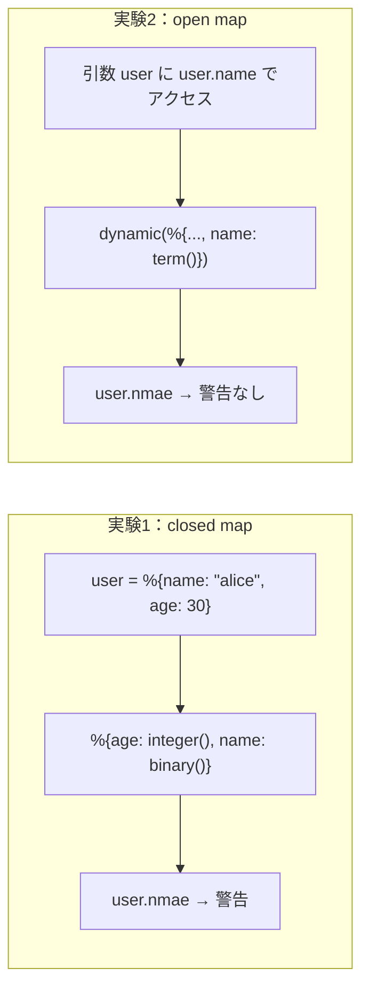

## はじめに

:::note info
この記事のまとめ

Elixir 1.20.5 のコンパイラは、型注釈がなくても、マップのキー、タプルの要素数、構造体のフィールド名を追跡し、存在しないキーや要素へのアクセスを警告します。

一方で、引数として受け取った<ruby>open map<rt>開いたマップ</rt></ruby>のキー名ミスや、パターンマッチで受け取った構造体のフィールドの型までは追えません。どこまで追えて、どこから追えないかを、最小のコードと実機ログで確かめます。

実務でのポイント：引数を `%User{} = user` のように構造体でパターンマッチしておくと、`user.nmae` のようなフィールド名のミスがコンパイル時に警告されます（実験8）。
:::

第1回では、型注釈を書かなくてもコンパイラが型を推論し、`dynamic()` の範囲と期待型に共通部分がないときに警告を出すことを確かめました。

第2回は、Elixir のコードで日常的に使うマップ・タプル・構造体に対して、この推論がどこまで細かく効くのかを見ていきます。

### 検証環境

第1回と同じ環境です。

```text
Erlang/OTP 29 [erts-17.1.1] [source] [64-bit] [smp:10:10] [ds:10:10:10] [async-threads:1] [jit]

Elixir 1.20.5 (compiled with Erlang/OTP 29)
```

検証用のスクリプトは3つです。それぞれ `elixir` コマンドでそのまま実行し、すべて終了コード `0`（警告のみ）でした。各節では、出力から該当する警告だけを抜き出して載せています。

---

## マップ：<ruby>closed map<rt>閉じたマップ</rt></ruby>と<ruby>open map<rt>開いたマップ</rt></ruby>

公式ドキュメントでは、マップの型に <ruby>closed map<rt>閉じたマップ</rt></ruby> と <ruby>open map<rt>開いたマップ</rt></ruby> の2種類があると説明されています。

https://elixir.hexdocs.pm/1.20.5/gradual-set-theoretic-types.html

- **<ruby>closed map<rt>閉じたマップ</rt></ruby>** `%{name: binary(), age: integer()}`：書かれたキーだけを持つマップ
- **<ruby>open map<rt>開いたマップ</rt></ruby>** `%{..., name: binary(), age: integer()}`：書かれたキーは必ず持ち、それ以外のキーもあってよいマップ

この違いが、キー名のミスを警告できるかどうかを分けます。

```elixir:exp1_maps.exs
defmodule MapClosed do
  def demo do
    user = %{name: "alice", age: 30}
    user.nmae
  end
end

defmodule MapOpen do
  def demo(user) do
    name = user.name
    {name, user.nmae}
  end
end

defmodule MapGuard do
  def demo(user) when not is_map_key(user, :name), do: user.name
  def demo(user), do: user
end

defmodule MapDelete do
  def demo(user) do
    user = Map.delete(user, :age)
    user.age
  end
end
```

```bash
elixir exp1_maps.exs
```

### 実験1：リテラルで作ったマップのキー名ミスは警告される

`MapClosed` では、`:name` を `:nmae` と書き間違えています。

```text
    warning: unknown key .nmae in expression:

        user.nmae

    the given type does not have the given key:

        %{age: integer(), name: binary()}

    where "user" was given the type:

        # type: %{age: integer(), name: binary()}
        # from: exp1_maps.exs:3:10
        user = %{name: "alice", age: 30}

    type warning found at:
    │
  4 │     user.nmae
    │          ~~~~
    │
    └─ exp1_maps.exs:4:10: MapClosed.demo/0
```

`user` の型は `%{age: integer(), name: binary()}` と推論されています。`...` がないので<ruby>closed map<rt>閉じたマップ</rt></ruby>です。キーは `:name` と `:age` だけと確定しているため、`:nmae` は存在しないと判定されます。

値の型も、`"alice"` から `binary()`、`30` から `integer()` と推論されています。

### 実験2：引数で受け取ったマップのキー名ミスは警告されない

`MapOpen` でも同じく `:nmae` と書き間違えていますが、このモジュールに対する警告は出力されませんでした。

`user` は引数なので、最初は `dynamic()` です。第1回で確かめたとおり、`user.name` にアクセスすると `user` は `dynamic(%{..., name: term()})` という<ruby>open map<rt>開いたマップ</rt></ruby>と推論されます。<ruby>open map<rt>開いたマップ</rt></ruby>は `:name` 以外のキーを持っていてもよい型なので、`:nmae` が存在しないとは言い切れません。そのため警告は出ません。



### 実験3：ガードで「キーがない」と確定させると警告される

`MapGuard` では、ガード `not is_map_key(user, :name)` で `:name` キーがないことを確かめたうえで、`user.name` にアクセスしています。

```text
    warning: unknown key .name in expression:

        user.name

    the given type does not have the given key:

        dynamic(%{..., name: not_set()})

    where "user" was given the types:

        # type: dynamic(%{..., name: not_set()})
        # from: exp1_maps.exs:16:12
        user

        # type: %{..., name: not_set()}
        # from: exp1_maps.exs:16:27
        is_map_key(user, :name)

    type warning found at:
    │
 16 │   def demo(user) when not is_map_key(user, :name), do: user.name
    │                                                             ~~~~
    │
    └─ exp1_maps.exs:16:61: MapGuard.demo/1
```

`not_set()` は、そのキーが存在しないことを表す型です。<ruby>open map<rt>開いたマップ</rt></ruby>でも、ガードで「`:name` はない」と確定した後なら、`user.name` は確実に失敗すると判定されます。

この挙動は、Elixir 1.20 のリリースブログで `not is_map_key(x, :foo)` の例として紹介されているものと同じです。

https://elixir-lang.org/blog/2026/06/03/elixir-v1-20-0-released/

### 実験4：`Map.delete/2` で消したキーへのアクセスは警告される

`MapDelete` では、`Map.delete(user, :age)` で `:age` を消した後に `user.age` にアクセスしています。

```text
    warning: unknown key .age in expression:

        user.age

    the given type does not have the given key:

        dynamic(%{..., age: not_set()})

    where "user" was given the type:

        # type: dynamic(%{..., age: not_set()})
        # from: exp1_maps.exs:22:10
        user = Map.delete(user, :age)

    type warning found at:
    │
 23 │     user.age
    │          ~~~
    │
    └─ exp1_maps.exs:23:10: MapDelete.demo/1
```

`Map.delete/2` の戻り値は `%{..., age: not_set()}` と推論されています。公式ドキュメントでも、`%{..., age: not_set()}` は `Map.delete(map, :age)` が返す型として紹介されています。ガードだけでなく、標準ライブラリの関数の戻り値からもキーの有無が追跡されています。

---

## タプル：要素数の追跡

公式ドキュメントでは、タプルの型は `{:ok, binary()}` のように書き、末尾に `...` を付けると「要素数が決まっていない（少なくともその数の要素がある）タプル」を表すと説明されています。

```elixir:exp2_tuples.exs
defmodule TuplePattern do
  def demo({:ok, _value} = result), do: elem(result, 2)
end

defmodule TupleMatch do
  def demo(x) do
    {status, value, meta} = {:ok, x}
    {status, value, meta}
  end
end

defmodule TupleSizeEq do
  def demo(x) when tuple_size(x) == 2, do: elem(x, 3)
end

defmodule TupleSizeLt do
  def demo(x) when tuple_size(x) < 3, do: elem(x, 3)
end
```

```bash
elixir exp2_tuples.exs
```

### 実験5：パターンマッチで要素数が確定したタプル

`TuplePattern` では、引数を `{:ok, _value}` でパターンマッチし、3番目の要素（インデックス2）を取り出しています。

```text
    warning: expected a tuple with at least 3 elements in Kernel.elem/2:

        elem(result, 2)

    the given type does not have the given index:

        dynamic({:ok, term()})

    where "result" was given the type:

        # type: dynamic({:ok, term()})
        # from: exp2_tuples.exs:2:26
        {:ok, _value} = result

    type warning found at:
    │
  2 │   def demo({:ok, _value} = result), do: elem(result, 2)
    │                                         ~
    │
    └─ exp2_tuples.exs:2:41: TuplePattern.demo/1
```

パターン `{:ok, _value}` から、`result` は「1番目が `:ok` の2要素タプル」`{:ok, term()}` と推論されています。末尾に `...` がないので、要素数は2で確定しています。そのため、`elem(result, 2)` は「少なくとも3要素が必要」として警告されます。

### 実験6：要素数の合わないパターンマッチ

`TupleMatch` では、2要素のタプル `{:ok, x}` を3要素のパターン `{status, value, meta}` で受けています。

```text
    warning: the following pattern will never match:

        {status, value, meta} = {:ok, x}

    because the right-hand side has type:

        dynamic({:ok, term()})

    where "x" was given the type:

        # type: dynamic()
        # from: exp2_tuples.exs:6:12
        x

    type warning found at:
    │
  7 │     {status, value, meta} = {:ok, x}
    │                           ~
    │
    └─ exp2_tuples.exs:7:27: TupleMatch.demo/1
```

`x` 自体は `dynamic()` でも、右辺のタプルの要素数は2と確定しています。そのため、3要素のパターンは「決してマッチしない（will never match）」と警告されます。

### 実験7：`tuple_size/1` のガードによる要素数の推論

`TupleSizeEq` では、ガード `tuple_size(x) == 2` で要素数を2に限定したうえで、`elem(x, 3)` にアクセスしています。

```text
    warning: expected a tuple with at least 4 elements in Kernel.elem/2:

        elem(x, 3)

    the given type does not have the given index:

        dynamic({term(), term()})

    where "x" was given the types:

        # type: dynamic({term(), term()})
        # from: exp2_tuples.exs:13:12
        x

        # type: {term(), term()}
        # from: exp2_tuples.exs:13:34
        tuple_size(x) == 2

    type warning found at:
    │
 13 │   def demo(x) when tuple_size(x) == 2, do: elem(x, 3)
    │                                            ~
    │
    └─ exp2_tuples.exs:13:44: TupleSizeEq.demo/1
```

ガード `tuple_size(x) == 2` から、`x` は `{term(), term()}`（2要素のタプル）と推論されています。`where` 欄には、引数 `x` とガードの式の両方が型の発生源として表示されています。

一方、`TupleSizeLt`（ガードが `tuple_size(x) < 3`）からは、警告は出力されませんでした。

:::note warn
リリースブログの「Typing guards, clauses, and more」の節では、`def example(x) when tuple_size(x) < 3` の例について、タプルの要素数が多くとも2つであることを追跡し、`elem(x, 3)` へのアクセスは型の違反になると説明されています。

しかし、手元の Elixir 1.20.5 で `TupleSizeLt` を実行したところ、警告は出ませんでした。`==` で要素数を確定させた `TupleSizeEq` では警告が出ています。
:::

---

## 構造体：フィールド名は追えるが、フィールドの型は追えない

```elixir:exp3_structs.exs
defmodule User do
  defstruct [:name, :age]
end

defmodule StructKey do
  def demo(%User{} = user), do: user.nmae
end

defmodule StructFieldFromPattern do
  def demo(%User{} = user), do: user.age + 1
end

defmodule StructFieldFromLiteral do
  def demo do
    user = %User{name: "alice", age: "30"}
    user.age + 1
  end
end
```

```bash
elixir exp3_structs.exs
```

### 実験8：構造体のフィールド名のミスは警告される

`StructKey` では、引数を `%User{}` でパターンマッチし、存在しないフィールド `nmae` にアクセスしています。

```text
    warning: unknown key .nmae in expression:

        user.nmae

    the given type does not have the given key:

        dynamic(%User{name: term(), age: term()})

    where "user" was given the type:

        # type: dynamic(%User{})
        # from: exp3_structs.exs:6:20
        %User{} = user

    type warning found at:
    │
  6 │   def demo(%User{} = user), do: user.nmae
    │                                      ~~~~
    │
    └─ exp3_structs.exs:6:38: StructKey.demo/1
```

`%User{}` とパターンマッチしただけで、`user` は `dynamic(%User{name: term(), age: term()})` と推論されています。構造体のフィールドは `defstruct` で決まっているため、引数として受け取った値でも、存在しないフィールドへのアクセスは警告されます。実験2の<ruby>open map<rt>開いたマップ</rt></ruby>とは、ここが異なります。

### 実験9：フィールドの型はパターンマッチからは分からない

上の型表示を見ると、フィールドの型はどちらも `term()`（任意の値）です。そのため、`StructFieldFromPattern` の `user.age + 1` からは警告は出力されませんでした。

一方、`StructFieldFromLiteral` のように、同じ関数内で構造体をリテラルで作った場合は、フィールドに入れた値から型が推論されます。

```text
    warning: incompatible types given to Kernel.+/2:

        user.age + 1

    given types:

        binary(), integer()

    but expected one of:

        #1
        integer(), integer()

        #2
        integer(), float()

        #3
        float(), integer()

        #4
        float(), float()

    where "user" was given the type:

        # type: %User{name: binary(), age: binary()}
        # from: exp3_structs.exs:15:10
        user = %User{name: "alice", age: "30"}

    type warning found at:
    │
 16 │     user.age + 1
    │              ~
    │
    └─ exp3_structs.exs:16:14: StructFieldFromLiteral.demo/0
```

`age: "30"` から `age` は `binary()` と推論され、`binary() + integer()` は成り立たないため警告されます。

Elixir 1.20 には、構造体のフィールドに型を宣言する仕組みはまだありません。公式ドキュメントの「Roadmap」では、次のマイルストーンで型付きの構造体を定義する仕組みを入れる予定と書かれています。

---

## まとめと次回予告

第2回で確かめた結果を、追えたもの・追えなかったものに分けて整理します。

| 対象 | 確かめた操作 | 警告 |
| :--- | :--- | :--- |
| マップ（リテラルで作成） | 存在しないキーへのアクセス | 出た |
| マップ（引数で受け取り） | 存在しないキーへのアクセス | 出なかった |
| マップ（`not is_map_key` のガード後） | ないと確定したキーへのアクセス | 出た |
| マップ（`Map.delete/2` の後） | 消したキーへのアクセス | 出た |
| タプル（パターンマッチで受け取り） | 要素数を超えるインデックスへの `elem/2` | 出た |
| タプル（リテラル） | 要素数の合わないパターンマッチ | 出た |
| タプル（`tuple_size(x) == 2` のガード後） | 要素数を超えるインデックスへの `elem/2` | 出た |
| タプル（`tuple_size(x) < 3` のガード後） | 要素数を超えるインデックスへの `elem/2` | 出なかった |
| 構造体（パターンマッチで受け取り） | 存在しないフィールドへのアクセス | 出た |
| 構造体（パターンマッチで受け取り） | フィールドの型が合わない演算 | 出なかった |
| 構造体（リテラルで作成） | フィールドの型が合わない演算 | 出た |

型注釈を書かなくても、値の作り方（リテラル）、パターンマッチ、ガード、標準ライブラリの戻り値から、キーや要素数がかなり細かく追跡されています。追えなかったケースは、引数のマップのように「ほかのキーがありうる」場合や、構造体のフィールドの型のように「まだ型を宣言する手段がない」場合でした。

引数のマップのキー名ミスを拾わせたいときは、`%User{}` のように構造体でパターンマッチしておくと、フィールド名のミスが警告されるようになります（実験8）。

次回（第3回）は、複数の節（clause）や `case` / `cond` / `with` で、上の節から下の節へ型がどう絞り込まれていくか（Occurrence Typing）と、到達しない節の検出を実機で確かめます。
