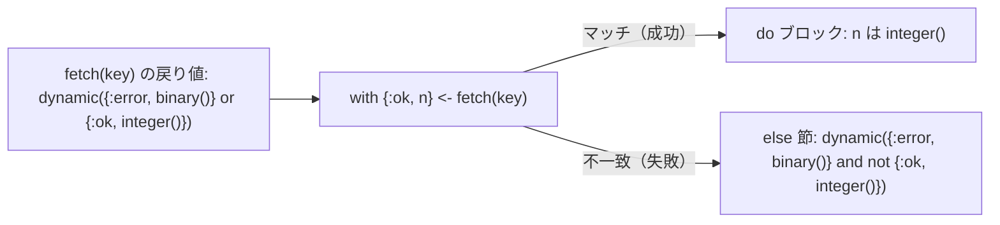

## はじめに

:::note info
この記事のまとめ

Elixir 1.20 のコンパイラは、関数節・`case`・`cond`・`with` の分岐を上から順にたどり、**上の節で処理した型を下の節から自動で引き算**します。

実務で効いてくるのは次の2点です。

1. 上の節で `nil` やエラーを先に処理しておけば、下の節では「残った型」として安全に扱える
2. 前の節ですでに全部処理してしまい、絶対に到達しない節（デッドコードや書き順ミス）をコンパイラが警告で教えてくれる
:::

この仕組みは型理論では **Occurrence Typing（型絞り込み）** と呼ばれますが、言葉そのものを覚える必要はありません。「上から下へ、処理済みの型が削られていく」とイメージすれば十分です。

これまでの連載はこちらです。

https://qiita.com/torifukukaiou/items/99fd9c95038816fe35c4

https://qiita.com/torifukukaiou/items/cc59704fecefa081136c

節をまたぐ型の絞り込みは、Elixir 1.20 のリリースブログの「Typing guards, clauses, and more」の節で解説されています。

https://elixir-lang.org/blog/2026/06/03/elixir-v1-20-0-released/


### 検証環境

第1回・第2回と同じ環境です。

```text
Erlang/OTP 29 [erts-17.1.1] [source] [64-bit] [smp:10:10] [ds:10:10:10] [async-threads:1] [jit]

Elixir 1.20.5 (compiled with Erlang/OTP 29)
```

検証用のスクリプトは3つです。すべて `elixir` コマンドでそのまま実行し、終了コード `0`（警告のみ）でした。各節では、出力から該当する警告だけを抜き出して載せています。

---

## 複数関数節と `case`：絞り込みと冗長節の検出

まずは、もっともよく書く `case` と複数関数節で、型の絞り込みと「絶対に到達しない節」の検出を確かめます。

```elixir:exp1_case_and_clauses.exs
defmodule CaseNarrowing do
  def fetch(:a), do: 10
  def fetch(_), do: nil

  def format(key) do
    case fetch(key) do
      nil -> "none"
      n -> Integer.to_string(n)
    end
  end
end

defmodule CaseRedundantAtom do
  def check(x) do
    case x do
      x when is_atom(x) -> :atom
      nil -> :nil
      _ -> :other
    end
  end
end

defmodule ClauseRedundant do
  def classify(x) when is_number(x), do: :number
  def classify(x) when is_integer(x), do: :integer
  def classify(_), do: :other
end

defmodule CaseExhaustive do
  def status(flag) do
    if flag, do: :ok, else: :error
  end

  def label(flag) do
    case status(flag) do
      :ok -> "OK"
      :error -> "NG"
      _ -> "UNKNOWN"
    end
  end
end
```

```bash
elixir exp1_case_and_clauses.exs
```

### 実験1：`nil` を先に処理すると次の節で安全に使える（警告なし）

`CaseNarrowing` では、`fetch(key)` の戻り値が `dynamic(nil or integer())` です。1節目の `nil -> "none"` で `nil` を処理しているため、2節目の `n` から `nil` が除外され、`Integer.to_string(n)` に渡しても警告は出ませんでした。

これは、リリースブログの「Typing guards, clauses, and more」の節で、前の節の情報で後の節を絞り込む例として紹介されている `case System.get_env("SOME_VAR") do nil -> ... value -> ... end` と同じ形です。

### 実験2：`is_atom(x)` の後ろに `nil ->` を書くと冗長と警告される

`CaseRedundantAtom` では、`x when is_atom(x)` の後ろに `nil -> :nil` を置いています。

```text
    warning: the following clause is redundant:

        nil ->

    previous clauses have already matched on the following types:

        atom()

    type warning found at:
    │
 17 │       nil -> :nil
    │           ~
    │
    └─ exp1_case_and_clauses.exs:17:11: CaseRedundantAtom.check/1
```

Elixir では `nil` も `atom()` の一種（部分集合）です。1節目で `atom()` 全体を受け止めているため、2節目の `nil ->` は決して実行されない冗長な節（`redundant`）として警告されます。`nil` を別扱いしたい場合は、`nil ->` を上に書く必要があります。

### 実験3：複数関数節での包含関係（`is_number` の後ろの `is_integer`）

`ClauseRedundant` では、1節目に `is_number(x)`、2節目に `is_integer(x)` を並べています。

```text
    warning: the following clause is redundant:

        def classify(x) when is_integer(x)

    it has type:

        integer()

    previous clauses have already matched on the following types:

        float() or integer()

    │
 25 │   def classify(x) when is_integer(x), do: :integer
    │       ~
    │
    └─ exp1_case_and_clauses.exs:25:7: ClauseRedundant.classify/1
```

`is_number(x)` は `float() or integer()` にマッチするため、その下の `integer()` の節はすでに包含されています。ガードの書き順ミスをコンパイル時に見つけてくれます。

### 実験4：全パターンを処理した後の `_ ->` も検出される

`CaseExhaustive` では、`status(flag)` が `:ok` か `:error` の2通りしか返しません。その2つを処理した後ろにフォールバックの `_ -> "UNKNOWN"` を置いています。

```text
    warning: the following clause cannot match because the previous clauses already matched all possible values:

        _ ->

    it attempts to match on the result of:

        status(flag)

    which has the already matched type:

        dynamic(:error or :ok)

    type warning found at:
    │
 38 │       _ -> "UNKNOWN"
    │         ~
    │
    └─ exp1_case_and_clauses.exs:38:9: CaseExhaustive.label/1
```

`status(flag)` の取りうる値が `dynamic(:error or :ok)` であると推論されているため、`:ok` と `:error` を処理した時点で残りが空になり、`_ ->` は到達不能と警告されました。

---

## `cond`：1段ずつ型が削られる履歴を追う

次は `cond` です。ガード関数や述語を上から順に並べたとき、下の節へどのように否定型が積み重なっていくかを確かめます。

```elixir:exp2_cond.exs
defmodule CondNarrowing do
  def demo(x) do
    cond do
      is_integer(x) -> x * 2
      is_float(x) -> x * 2
      true -> x + 1
    end
  end
end

defmodule CondRedundant do
  def demo(x) do
    cond do
      is_number(x) -> :number
      is_integer(x) -> :integer
      true -> :other
    end
  end
end

defmodule CondNilCheck do
  def fetch(:a), do: 10
  def fetch(_), do: nil

  def format(key) do
    val = fetch(key)

    cond do
      is_nil(val) -> "none"
      true -> Integer.to_string(val)
    end
  end
end
```

```bash
elixir exp2_cond.exs
```

### 実験5：`cond` で2段に分けて除外すると、3節目で矛盾が検出される

`CondNarrowing` では、1節目で `is_integer(x)`、2節目で `is_float(x)` を処理し、3節目の `true ->` で `x + 1` を実行しています。

```text
    warning: incompatible types given to Kernel.+/2:

        x + 1

    given types:

        dynamic(not float() and not integer()), integer()

    but expected one of:

        #1
        integer(), integer()

        #2
        integer(), float()

        #3
        float(), integer()

        #4
        float(), float()

    where "x" was given the types:

        # type: dynamic(not integer())
        # from: exp2_cond.exs:4:7
        is_integer(x)

        # type: dynamic(not float() and not integer())
        # from: exp2_cond.exs:5:7
        is_float(x)

    type warning found at:
    │
  6 │       true -> x + 1
    │                 ~
    │
    └─ exp2_cond.exs:6:17: CondNarrowing.demo/1
```

注目したいのは `where` 欄です。

`cond` では、上の条件が `false` になって次の節へ進むことを、ここでは「通過」と呼びます。

- 4行目の `is_integer(x)` を通過した時点で `dynamic(not integer())`
- 5行目の `is_float(x)` を通過した時点で `dynamic(not float() and not integer())`

このように、上の節を通過するたびに型が1段ずつ削られていく過程が、そのまま警告ログに出力されています。

### 実験6：`cond` の中で常に `false` になる条件も検出される

`CondRedundant` では、`is_number(x)` の後ろに `is_integer(x)` を書いています。

```text
    warning: this clause in cond will never match:

        is_integer(x)

    since it has type:

        dynamic(false)

    where "x" was given the type:

        # type: dynamic(not float() and not integer())
        # from: exp2_cond.exs:14:7
        is_number(x)

    type warning found at:
    │
 15 │       is_integer(x) -> :integer
    │                     ~
    │
    └─ exp2_cond.exs:15:21: CondRedundant.demo/1
```

14行目の `is_number(x)` を通過した `x` は `dynamic(not float() and not integer())` になるため、15行目の `is_integer(x)` の評価結果が `dynamic(false)` になると推論され、`will never match` の警告が出ます。

### 実験7：`is_nil(val)` の後ろの `true ->` 節（警告なし）

`CondNilCheck` では、`is_nil(val)` で `nil` を処理したあとの `true ->` 節で `Integer.to_string(val)` を呼んでいます。`val` から `nil` が除外されているため、警告は出ませんでした。

---

## `with` と `else` 節：成功パターンが引かれた残りを追う

実務の Elixir コードでよく使う `with` についても、成功パスと `else` 節で型がどう絞り込まれるかを確かめます。

```elixir:exp3_with.exs
defmodule WithElseNarrowing do
  def fetch(:a), do: {:ok, 10}
  def fetch(_), do: {:error, "not found"}

  def run(key) do
    with {:ok, n} <- fetch(key) do
      n + 1
    else
      {:error, msg} -> String.upcase(msg)
    end
  end
end

defmodule WithElseIncompatible do
  def fetch(:a), do: {:ok, 10}
  def fetch(_), do: {:error, "not found"}

  def run(key) do
    with {:ok, n} <- fetch(key) do
      n + 1
    else
      {:error, msg} -> msg + 1
    end
  end
end

defmodule WithElseRedundant do
  def fetch(:a), do: {:ok, 10}
  def fetch(_), do: {:error, "not found"}

  def run(key) do
    with {:ok, n} <- fetch(key) do
      n + 1
    else
      {:ok, _} -> :impossible
      {:error, msg} -> msg
    end
  end
end

defmodule WithAlwaysOk do
  def ok_only(x), do: {:ok, x}

  def run(x) do
    with {:ok, v} <- ok_only(x) do
      v
    else
      _ -> :unreachable
    end
  end
end
```

```bash
elixir exp3_with.exs
```



### 実験8：`else` 節のエラー値に対しても型矛盾が警告される

`WithElseNarrowing` は `msg` を `String.upcase/1` に渡しているため警告なしでした。一方、`WithElseIncompatible` のように `else` 節で `msg + 1` と書くと、次の警告が出ます。

```text
    warning: incompatible types given to Kernel.+/2:

        msg + 1

    given types:

        binary(), integer()

    but expected one of:

        #1
        integer(), integer()

        #2
        integer(), float()

        #3
        float(), integer()

        #4
        float(), float()

    where "msg" was given the type:

        # type: binary()
        # from: exp3_with.exs
        {:error, msg}

    type warning found at:
    │
 22 │       {:error, msg} -> msg + 1
    │                            ~
    │
    └─ exp3_with.exs:22:28: WithElseIncompatible.run/1
```

`fetch/1` のエラー側のタプル `{:error, "not found"}` から、`else` 節の `msg` は `binary()` と推論されています。

### 実験9：`else` 節に成功パターン `{:ok, _}` を書くと到達不能と警告される

`WithElseRedundant` では、`with` 本体ですでに `{:ok, n}` にマッチさせているにもかかわらず、`else` 節に `{:ok, _} -> :impossible` を書いています。

```text
    warning: the following clause will never match:

        {:ok, _} ->

    it is expected to match on type:

        dynamic({:error, binary()} and not {:ok, integer()})

    type warning found at:
    │
 35 │       {:ok, _} -> :impossible
    │       ~~~~~~~~~~~~~~~~~~~~~~~
    │
    └─ exp3_with.exs:35: WithElseRedundant.run/1
```

`else` 節に渡ってくる型が `dynamic({:error, binary()} and not {:ok, integer()})` と表示されています。`with` の成功パターンが否定（`and not {:ok, integer()}`）として差し引かれていることがわかります。

### 実験10：必ず成功する `with` に `else` 節を書くと `none()` で警告される

`WithAlwaysOk` では、常に `{:ok, x}` を返す関数に対して `else` 節を書いています。

```text
    warning: the following clause will never match:

        _ ->

    it is expected to match on type:

        none()

    type warning found at:
    │
 48 │       _ -> :unreachable
    │       ~
    │
    └─ exp3_with.exs:48:7: WithAlwaysOk.run/1
```

`else` 節に届く型が空集合 `none()` と推論され、到達しない `else` 節として警告されました。

---

## まとめと次回予告

第3回で実機確認した結果をまとめます。

| 構文 | 確かめたケース | 警告 |
| :--- | :--- | :--- |
| `case` | `nil` を先に処理し、次の節で `Integer.to_string/1` に渡す | 出なかった |
| `case` | `is_atom(x)` の後ろに `nil ->` を書く | 出た（`redundant`） |
| 複数関数節 | `is_number(x)` の後ろに `is_integer(x)` を書く | 出た（`redundant`） |
| `case` | `:ok` と `:error` を処理した後ろに `_ ->` を書く | 出た（`cannot match`） |
| `cond` | `is_integer(x)` と `is_float(x)` の後ろの `true ->` で `x + 1` | 出た（`incompatible types`） |
| `cond` | `is_number(x)` の後ろに `is_integer(x)` を書く | 出た（`will never match`） |
| `cond` | `is_nil(val)` の後ろの `true ->` で `Integer.to_string/1` に渡す | 出なかった |
| `with` | `else` 節でエラー値（`binary()`）に `+ 1` をする | 出た（`incompatible types`） |
| `with` | `else` 節に本体でマッチ済みの `{:ok, _}` を書く | 出た（`will never match`） |
| `with` | 常に `{:ok, x}` を返す関数に `else _ ->` を書く | 出た（`none()` / `will never match`） |

関数節・`case`・`cond`・`with` のいずれでも、「上の節で処理した型が下の節から削られる」という一貫したルールで動いています。書き順のミスや、リファクタリング後に残ってしまった不要な `else` 節・フォールバック節をコンパイラが見つけてくれるので、警告が出た箇所を見直すだけでもコードの整理が進みます。

次回（第4回）は、別モジュール・標準ライブラリ・依存パッケージをまたいだときに型推論がどこまで届くか（アプリ横断の推論と `dynamic()` の境界）を実機で確かめます。

